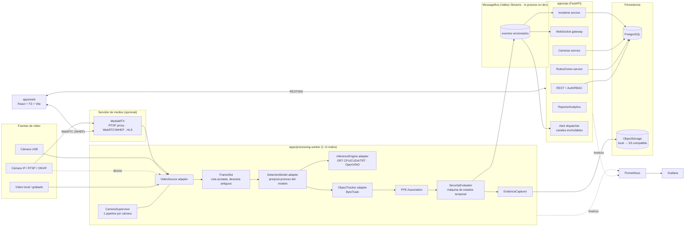
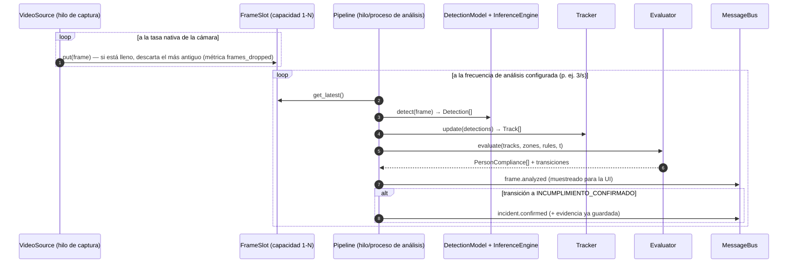
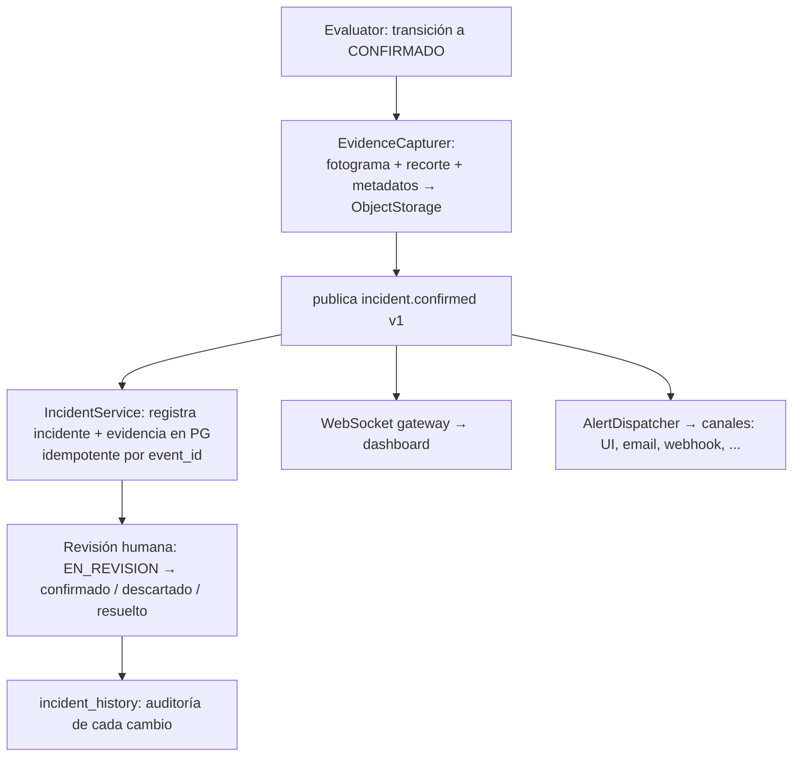
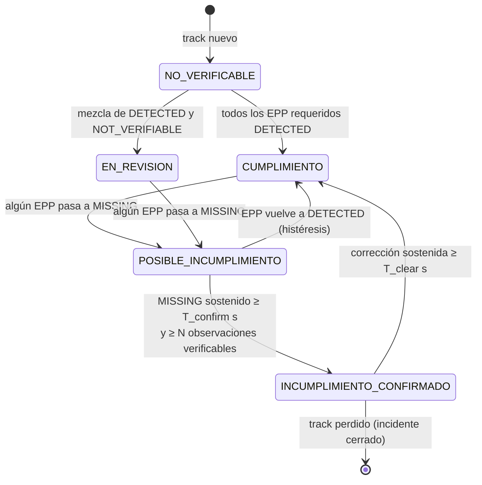

# Arquitectura — Security Vision

> **Diseño frente a lo implementado (revisado en la Fase 10).** Este documento es el diseño de la V1. Lo que se construyó y verificó difiere en estos puntos; el resto se implementó como está descrito:
>
> | Diseño | Implementado | Motivo |
> |---|---|---|
> | Bus de eventos en Valkey Streams | **PostgreSQL LISTEN/NOTIFY + outbox transaccional** (ADR-0011, ADR-0019) | Menos piezas; entrega fiable con el outbox. El puerto `MessageBus` permite cambiarlo |
> | Adaptadores de vídeo PyAV **y GStreamer** | Solo **PyAV/FFmpeg** (RTSP, USB, archivo) y un patrón de prueba | PyAV cubre Windows y Linux. GStreamer queda como adaptador futuro |
> | Almacenamiento S3 compatible (escala intermedia) | Solo **almacenamiento local** con URL firmadas | Puerto `ObjectStorage` preparado |
> | Varios workers con asignación de cámaras (`processing_nodes`) | **Un worker** con micro-batching (Fase 9) | Capacidad medida suficiente para el hardware disponible |
> | TensorRT | Proveedor soportado en el motor, **sin medir** (descarga no completada, Fase 9) | Ver docs/progress/fase-9.md |
> | MediaMTX con usuarios internos | **Autorización HTTP contra la API** (Fase 10, ADR-0032) | Vídeo en directo con la sesión web, auditado |
> | DeepStream / Jetson | No implementado | Escala avanzada, fuera de la V1 |


Plataforma modular de videovigilancia con análisis de seguridad (EPP) mediante IA. Nombre de trabajo: `security-vision`. No está ligada a ningún sector.

## 1. Principios aplicados

| Principio | Cómo se materializa |
|---|---|
| Arquitectura hexagonal (puertos y adaptadores) | `core/` define el dominio y los puertos (interfaces). Las tecnologías concretas viven en `plugins/` e `infrastructure/`. El dominio no importa nada de terceros, salvo `pydantic` para los contratos de datos. |
| Bajo acoplamiento | Los procesos se comunican mediante **eventos versionados** sobre un `MessageBus` abstracto. El motor de detección no conoce al de alertas. |
| Proveedores intercambiables | Hay un registro de proveedores (`ProviderRegistry`) resuelto por configuración. Los plugins se descubren mediante *entry points* de Python, así que un plugin de terceros se instala como paquete aparte sin tocar el núcleo. |
| Reglas de dependencia verificadas | `import-linter` en CI: `core` no depende de nada; `modules` depende de `core`; `plugins` e `infrastructure` dependen de `core`; solo `apps/*` (las raíces de composición) conocen a todos. |
| Procesamiento local primero | Todo funciona sin Internet ni servicios de pago. |
| Preparada para distribuirse | El worker de procesamiento es un proceso aparte, sin estado compartido en memoria con la API. Escalar consiste en añadir workers y asignarles cámaras. |

## 2. Diagrama de componentes



**Decisión clave:** el worker **no** sirve vídeo al navegador ni vuelve a codificar vídeo anotado. El navegador recibe el vídeo original de MediaMTX por WebRTC y dibuja las detecciones en un `<canvas>` superpuesto a partir de los metadatos que llegan por WebSocket. Así se ahorra la codificación (mucha CPU/GPU), la visualización se desacopla del análisis y la latencia del vídeo no depende de la frecuencia de inferencia.

## 3. Flujo de vídeo y procesamiento por cámara



- **Backpressure:** la captura y el análisis van desacoplados mediante `FrameSlot`, que siempre entrega el fotograma más reciente. El análisis nunca acumula vídeo atrasado.
- **Aislamiento:** cada cámara tiene su propio `CameraPipeline` con su ciclo de vida y reconexión con *backoff* exponencial. Si una cámara falla, solo se marca `camera.status_changed`; las demás siguen.
- **Inferencia compartida:** en GPU, varias cámaras comparten **una** instancia del `InferenceEngine` (la VRAM es limitada), con un planificador que puede agrupar fotogramas en lotes (*micro-batching*). En CPU se puede usar una instancia por proceso.
- **Modelo de ejecución (V1):** un proceso worker con hilos de captura (la E/S libera el GIL; PyAV y GStreamer también) y un hilo de inferencia. ONNX Runtime libera el GIL durante la ejecución. Si las mediciones lo justifican, pasaremos a un proceso por grupo de cámaras sin cambiar las interfaces.

## 4. Flujo de eventos e incidentes



Los consumidores son independientes y deben ser idempotentes, porque el bus garantiza entrega *al menos una vez*. Para añadir Telegram, WhatsApp o alarmas físicas basta con crear un nuevo `AlertChannel`.

## 5. Motor de evaluación de seguridad

Separado de la detección. Recibe `Track`s con sus asociaciones de EPP y mantiene un estado temporal por persona y por EPP.

### 5.1 Observación por fotograma y EPP

Para cada persona *p*, EPP *k* y fotograma *t*, la observación es una de estas tres:

- `PRESENT` — hay un EPP de clase *k* asociado espacialmente a *p* con confianza ≥ umbral.
- `ABSENT` — no hay EPP asociado **y** la región corporal correspondiente es **verificable**.
- `UNVERIFIABLE` — la región no es verificable: fuera de cuadro, truncada por el borde, demasiado pequeña (p. ej. la región de la cabeza mide menos de N px), ocluida por otra persona (IoU alto con otro track) o con baja confianza de la persona.

La verificabilidad la decide cada regla de EPP (`PPERule.region_of_interest()` + `is_verifiable()`). Por eso añadir gafas o guantes significa añadir una regla, no modificar el motor.

### 5.2 Agregación temporal por EPP (ventana deslizante)

```
ventana de W segundos con observaciones {PRESENT, ABSENT, UNVERIFIABLE}
verifiable_ratio = (PRESENT + ABSENT) / total
si verifiable_ratio < min_verifiable_ratio         → NOT_VERIFIABLE
si PRESENT / (PRESENT+ABSENT) ≥ present_ratio      → DETECTED
si ABSENT  / (PRESENT+ABSENT) ≥ absent_ratio       → MISSING
en otro caso                                       → UNCERTAIN
```

### 5.3 Estado de la persona



Garantías:

- **Nunca** se confirma un incumplimiento a partir de un solo fotograma: hacen falta `T_confirm` segundos **y** un mínimo de observaciones *verificables* `ABSENT`.
- La ausencia de detección en una región no verificable produce `NO_VERIFICABLE`, nunca `MISSING`.
- **Antirrebote de incidentes:** como máximo un incidente abierto por (track, EPP). Si el track se pierde y reaparece dentro de una ventana, se asocia al mismo incidente mediante un *cooldown* configurable.
- Todos los umbrales viven en `SecurityProfile` y se pueden configurar por cámara y por zona.

### 5.4 Zonas

Las zonas son polígonos en coordenadas normalizadas [0,1] por cámara. Cada zona referencia un `SecurityProfile` (qué EPP se exigen y con qué umbrales). La pertenencia de una persona a una zona se calcula con el punto de apoyo (el centro inferior de su bbox). Las zonas restringidas (permanencia) se implementarán más adelante como otra regla sobre la misma estructura.

### 5.5 Asociación espacial persona–EPP

Primera implementación por geometría (sin dependencias de terceros):

- Casco: centro del bbox del casco dentro del tercio superior del bbox de la persona y `IoA(casco, persona) ≥ τ`.
- Chaleco: `IoA(chaleco, región del torso) ≥ τ`.
- Botas: centro dentro del 20 % inferior de la persona, con tolerancia por debajo del borde.
- Si un EPP es candidato para varias personas, se asigna mediante el algoritmo húngaro sobre un coste geométrico.

Detrás de la interfaz `PPEAssociator`, para poder sustituirlo más adelante por un modelo de pose o por detección *persona-con-EPP*.

## 6. Transmisión al navegador

| Escenario | Ruta |
|---|---|
| Cámara RTSP | MediaMTX hace de proxy de la cámara (`source: rtsp://...`). El worker consume el RTSP desde MediaMTX y el navegador lo recibe por WebRTC/WHEP. La cámara sirve **una sola** conexión. |
| Cámara USB | El worker captura y **republica** a MediaMTX (RTSP publish con H.264). Alternativa: MediaMTX ejecuta FFmpeg con `runOnInit`. |
| Sin MediaMTX (modo mínimo) | Snapshot MJPEG de baja tasa servido por la API. Es solo un *fallback* de diagnóstico. |

La sincronización entre el vídeo WebRTC y el overlay es aproximada (por *timestamp* de análisis). Basta para supervisión, pero no es exacta al fotograma; en el modo de revisión de incidentes la evidencia sí es exacta.

## 7. Seguridad del sistema

- Autenticación: JWT de acceso de vida corta (15 min) + *refresh token* rotativo almacenado con hash en BD (para poder revocar sesiones). Contraseñas con **Argon2id** (`argon2-cffi`).
- RBAC: roles `admin`, `supervisor`, `operator`, `viewer`, con permisos granulares (`cameras:write`, `incidents:review`, …) comprobados en dependencias de FastAPI.
- Credenciales RTSP cifradas en BD (AES-GCM mediante `cryptography`, con la clave en una variable de entorno o un archivo de secreto). Nunca se devuelven por la API, y las URLs se enmascaran en los logs.
- Evidencias: se sirven solo mediante endpoints autenticados con URLs firmadas de corta duración; nunca directamente desde el almacenamiento.
- Auditoría: `audit_log` para toda acción administrativa.
- No hay reconocimiento facial ni biometría. Los IDs de persona son temporales (por track) y no identifican a nadie. Opcional: difuminar rostros en las evidencias (fase posterior).

## 8. Observabilidad

`prometheus-client` en la API y en el worker, con métricas etiquetadas por `camera_id`: `sv_camera_fps`, `sv_capture_latency_seconds`, `sv_inference_seconds` (histograma), `sv_e2e_latency_seconds`, `sv_frames_dropped_total`, `sv_detections_total{class}`, `sv_incidents_total{type}`, `sv_camera_connection_errors_total`, `sv_camera_up`. Las de CPU/RAM/GPU vienen de `psutil` + `pynvml` (los exportadores node/DCGM son opcionales). Las trazas OpenTelemetry se añadirán en la Fase 9, con el SDK desactivado por defecto.

## 9. Escalabilidad por fases

| Fase | Cambio necesario |
|---|---|
| Inicial | 1 worker, bus in-process o Valkey, ORT CPU/CUDA, almacenamiento local. |
| Intermedia | N workers con asignación cámara→nodo (tabla `processing_nodes` + *lease* en Valkey), ORT TensorRT, almacenamiento S3 compatible. Solo configuración y adaptadores. |
| Avanzada | Adaptador `DeepStreamPipeline`: implementa el puerto `AnalysisPipeline` completo (captura+inferencia+tracking dentro de DeepStream) y emite los mismos `Track`s hacia el evaluador. Jetson se cubre con el mismo adaptador. Bus NATS/Kafka mediante un adaptador nuevo de `MessageBus`. |

Por eso el puerto `AnalysisPipeline` existe **además** de los puertos finos (`VideoSource`, `InferenceEngine`, …): DeepStream no permite intercambiar componentes sueltos, pero sí puede sustituir el pipeline entero sin tocar el evaluador ni lo que viene después.

## 10. Estructura del repositorio

Ajuste sobre la estructura propuesta: el código Python vive en **un solo paquete instalable** (`src/security_vision/`), así se evitan los *hacks* de `sys.path` y las reglas de dependencia se pueden verificar. `apps/` contiene solo las raíces de composición.

```
security-vision/
├── apps/
│   ├── api/                  # FastAPI: composición, routers, arranque
│   ├── processing-worker/    # composición del worker, CLI
│   └── web/                  # React + TS + Vite + Tailwind
├── src/security_vision/
│   ├── core/
│   │   ├── domain/           # entidades, value objects, enums (sin dependencias externas)
│   │   ├── interfaces/       # puertos: VideoSource, InferenceEngine, ...
│   │   ├── events/           # contratos de eventos versionados
│   │   ├── configuration/    # settings (pydantic-settings), perfiles
│   │   └── registry.py       # ProviderRegistry + descubrimiento por entry points
│   ├── modules/
│   │   ├── cameras/  video/  inference/  detection/  tracking/
│   │   ├── security_rules/  incidents/  alerts/  reports/  users/  analytics/
│   ├── infrastructure/
│   │   ├── database/ (SQLAlchemy, Alembic)  storage/  messaging/  monitoring/
│   └── plugins/
│       ├── video_sources/  (ffmpeg_pyav, gstreamer, opencv, file)
│       ├── inference_engines/ (onnxruntime, openvino)
│       ├── detection_models/  (rtdetr, rfdetr)
│       └── trackers/ (bytetrack)
├── ml/  datasets/ training/ evaluation/ export/ model_registry/
├── config/                   # YAML de ejemplo: cámaras, perfiles, modelos
├── tests/ unit/ integration/ performance/ end_to_end/
├── docs/ architecture/ installation/ api/ models/ decisions/
├── docker/  scripts/
├── pyproject.toml  uv.lock  .importlinter
├── .env.example  docker-compose.yml  THIRD_PARTY_LICENSES.md  README.md
```

## 11. Stack seleccionado para la V1 (y lo que se deja fuera)

| Área | V1 | Diferido / alternativa documentada |
|---|---|---|
| Python | 3.12 fijado con `uv` (máxima disponibilidad de *wheels*: TensorRT, OpenVINO, PyGObject) | 3.13 cuando todas las dependencias lo soporten |
| API | FastAPI, Pydantic v2, SQLAlchemy 2 (async), Alembic, asyncpg | — |
| BD | PostgreSQL 16+ | TimescaleDB para series temporales (revisar licencia TSL) |
| Bus/caché | In-process (dev) + **Valkey** Streams (BSD-3) | Redis ≥7.4 (licencia RSAL/SSPL/AGPL), NATS, Kafka |
| Vídeo | Adaptador **PyAV/FFmpeg** (Windows y Linux) + adaptador **GStreamer** (Linux/Docker) | OpenCV (auxiliar), DeepStream |
| Medios | MediaMTX | go2rtc (MIT) |
| Inferencia | ONNX Runtime (CPU, CUDA) | TensorRT EP, OpenVINO (fase intermedia; el adaptador OpenVINO se puede adelantar por ser útil en esta CPU Intel) |
| Detector | RT-DETR / RF-DETR afinado en persona + EPP (decisión tras evaluar en la Fase 3) | D-FINE, DEIM (Apache-2.0) |
| Tracking | ByteTrack (implementación propia o de `supervision`, MIT) | OC-SORT, BoT-SORT |
| Frontend | React, TS, Vite, Tailwind, TanStack Query, ECharts | — |
| Observabilidad | prometheus-client, Prometheus, Grafana | OpenTelemetry (Fase 9) |
| Almacenamiento | Sistema de archivos local | S3 compatible: SeaweedFS (Apache-2.0); MinIO es AGPL-3.0 |
| Reportes | openpyxl (Excel), WeasyPrint (PDF) | — |
| Anotación | CVAT (servicio aparte, no forma parte del producto) | Label Studio |
