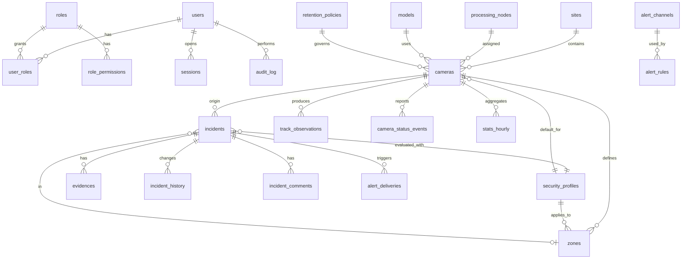

# Modelo de base de datos (PostgreSQL)

Convenciones: claves `uuid` (v7, ordenables por tiempo), `timestamptz` en UTC, `created_at`/`updated_at` en todas las tablas mutables, borrado lógico (`deleted_at`) donde haga falta para la auditoría. Los binarios (imágenes, vídeo) **nunca** se guardan en PostgreSQL; solo su `storage_key`.



## Tablas principales

| Tabla | Campos clave | Notas |
|---|---|---|
| `users` | id, email (único), display_name, password_hash (Argon2id), is_active, last_login_at, failed_logins, locked_until | |
| `roles`, `permissions`, `role_permissions`, `user_roles` | | RBAC granular |
| `sessions` | id, user_id, refresh_token_hash, user_agent, ip, expires_at, revoked_at | Revocación y rotación |
| `audit_log` | id, actor_id, action, entity_type, entity_id, before (jsonb), after (jsonb), ip, at | Solo inserción (append-only) |
| `sites` | id, name, description, timezone | Ubicación lógica (planta, almacén, obra…) |
| `cameras` | id, site_id, name, source_type (`usb`/`rtsp`/`onvif`/`file`), source_config (jsonb, **sin secretos**), credentials_encrypted (bytea), resolution, target_fps, analysis_fps, enabled, model_id, default_profile_id, processing_node_id, mediamtx_path, location (jsonb), retention_policy_id | `source_type` es un string resuelto por el registro de plugins; no es un enum cerrado |
| `camera_status_events` | camera_id, status, detail, at | Historial de conectividad |
| `processing_nodes` | id, hostname, capabilities (jsonb: devices, engines), last_heartbeat_at | Fase intermedia |
| `zones` | id, camera_id, name, polygon (jsonb, coordenadas normalizadas), kind (`ppe`/`restricted`/…), profile_id, enabled | |
| `security_profiles` | id, name, required_ppe (jsonb: lista de clases), thresholds (jsonb), version | Versionado: los incidentes referencian la versión aplicada |
| `models` | id, name, architecture, version, task, classes (jsonb), artifact_key, sha256, input_spec (jsonb), license, weights_license, dataset_ref, metrics (jsonb), status | Registro de modelos |
| `incidents` | id, camera_id, zone_id, profile_id+version, track_ref, violation_type, status (`EN_REVISION`/`CONFIRMADO`/`DESCARTADO`/`RESUELTO`), compliance_state, confidence, started_at, confirmed_at, ended_at, model_id, source_event_id (único → idempotencia) | |
| `evidences` | id, incident_id, kind (`frame`/`crop`/`clip`), storage_key, sha256, width, height, captured_at, frame_ts, metadata (jsonb: bboxes, scores, tiempo de inferencia) | El `sha256` permite verificar la integridad |
| `incident_history` | incident_id, actor_id, from_status, to_status, note, at | |
| `incident_comments` | incident_id, author_id, body, at | |
| `track_observations` | camera_id, track_id, ts, class, bbox, confidence, model_id, inference_ms, frame_ref | **Particionada por día**, con muestreo configurable. No se guarda cada fotograma: solo las muestras y las ventanas alrededor de los incidentes. Se purga según la retención |
| `stats_hourly` | camera_id, hour, persons_seen, compliant, violations_by_type (jsonb), fps_avg, dropped_frames | Alimenta el dashboard y los reportes sin escanear las observaciones |
| `alert_channels` | id, type (`ui`/`email`/`webhook`/…), config_encrypted, enabled | |
| `alert_rules` | id, channel_id, filter (jsonb: cámara, tipo, severidad), throttle_seconds | |
| `alert_deliveries` | id, incident_id, channel_id, status, attempts, last_error, at | Patrón *outbox* |
| `retention_policies` | id, evidences_days, observations_days, recordings_days, purge_on_resolved | |
| `event_outbox` | id, type, payload, created_at, published_at | Publicación transaccional de eventos desde la API |

## Contrato de una detección (en memoria y en eventos)

Cubre todos los campos que exige el requisito 4:

```python
class Detection(BaseModel):
    camera_id: UUID
    frame_id: int              # número de fotograma de origen
    frame_ts: datetime         # marca de tiempo del fotograma (captura)
    class_name: str            # "person", "helmet", "vest", "boots", ...
    class_id: int
    bbox: BBox                 # xyxy normalizado [0,1] + tamaño del fotograma
    confidence: float
    model_id: str              # nombre@versión
    inference_ms: float
    track_id: int | None = None  # identificador temporal, lo asigna el tracker
```
